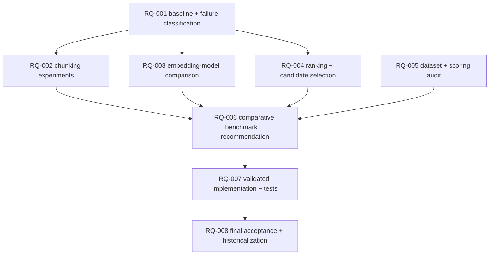

# PLAN — RAG-024: Retrieval quality investigation

**Type:** Investigation + validated improvement (retrieval/embedding/chunking/evaluation).
**Status:** PROPOSED (not activated). Requires operator activation before any task runs.
**Baseline:** `main` at `d4e8d88876ad798d404f64d88a4022465d9f148a` (includes RAG-023).
**Derived from:** the RAG-023D post-fix held-out evaluation (nomic R@1 0.42 / R@4 0.52 /
P@4 0.22 / evidence 0.48 / rejection 1.00 at floor 0.70) and a read-only preflight of the
retrieval, chunking, embedding, and evaluation code.
**Does not:** rewrite historical evaluation numbers, weaken the acceptance rule, tune the
threshold to make results pass, modify `rag_db`, or remove provider/filter capabilities.
Production embedding defaults (`nomic-embed-text`, `EmbedDim=768`, `QueryRewrite=true`)
are unchanged unless RQ-006 + operator authorization say otherwise.

## Project
rag-template

## Summary

Raise retrieval quality (recall@1/@4, precision@4, evidence recall) on the **held-out**
split **at the existing `0.70` acceptance floor** — without loosening the evaluation rule
(rejection-first, then recall@4) and without regressing RAG-023 guarantees (canonical
source identity, document-global chunk ordering, shared citation parser, atomic
replacement). Audit findings are kept **separate** from measured improvements so a
dataset/scoring artifact is never mistaken for a retrieval gain.

## Frozen inputs (must not change during the investigation)

- Held-out: `evals/retrieval-vi-en-expanded.json`, sha256 `7f6926df…cbd2d0df` (39 cases).
- Calibration: `evals/retrieval-vi-en-calibration.json`, sha256 `51be86ba…15444f2e` (21 cases).
- Corpus manifest: `evals/corpus-vi-en.json`, sha256 `2ddbef2f…fbc87b21` (8 documents).
- Acceptance rule: unchanged (`SWEEP_MIN_REJECTION=1`; highest recall@4, then rejection,
  then floor). The `0.70` floor is the acceptance threshold; it is **not** to be lowered to
  make a candidate pass.

## Baseline (recorded evidence, must reconcile)

RAG-023D post-fix rows (`docs/experiments-eval-sweep.md`), held-out, floor `0.70`, mean of
3 repeats: nomic-embed-text R@1 `0.42`, R@4 `0.52`, P@4 `0.22`, evidence `0.42→0.48`,
rejection `1.00`. The reported baseline reconciles exactly with these recorded rows; any
divergence discovered in RQ-001/RQ-005 is an audit finding, not a new baseline.

## RQ-001 — Evaluation baseline and failure classification

Reproduce the frozen baseline on a disposable database and classify every held-out miss,
using the opt-in, evaluation-only `EVAL_PREFILTER_DUMP` diagnostic to measure candidate loss
before and after similarity filtering.

> **Governance note (amended 2026-10-12).** In its first PASS the governed run edited the
> production file `cmd/eval/main.go` to add the default-OFF `EVAL_PREFILTER_DUMP` diagnostic
> while the task's original acceptance criterion still read "No production file changed".
> SOP recorded PASS nonetheless. This amendment **explicitly authorizes** that evaluation-only,
> default-OFF instrumentation (and its regression tests), resolving the discrepancy without
> rewriting history: the original requirement and the later authorization are both recorded.

### Deliverables
- **Create `docs/rq-001-baseline-failure-classification.md`** (a new, standalone report — not an
  append to `docs/experiments-eval-sweep.md`). It must contain:
  - reconciled baseline metrics and their source evidence;
  - a per-case retrieval failure classification (one row per held-out case);
  - failure categories grouped by language and query type;
  - candidate loss **before and after** similarity filtering (`KeepSimilar`), measured via
    `EVAL_PREFILTER_DUMP`;
  - hypotheses ranked by expected impact;
  - reproducible commands, configuration, and input hashes.
- **Evaluation-only instrumentation (authorized):** the opt-in, default-OFF
  `EVAL_PREFILTER_DUMP` diagnostic in `cmd/eval/main.go` (pre-filter candidates, kept/dropped
  counts, expected-section presence and pre-filter rank, dropped-by-floor list) **with focused
  regression tests**.
- Mark any observation current instrumentation cannot produce as **unavailable**, and name the
  bounded instrumentation needed to obtain it (do not invent measurements).

### Acceptance Criteria
- Baseline reproduced within recorded tolerance (metrics equal at floor `0.70`; run-wall
  and RSS recorded but not treated as model-quality metrics).
- Every one of the 33 answerable held-out cases carries a classification; the 6
  unanswerable cases confirm rejection.
- **No change to default evaluation behavior:** with `EVAL_PREFILTER_DUMP` unset/false the
  cmd/eval output is unchanged (same metrics), verified by a regression test.
- **Deterministic, bounded diagnostic output** (one block per case × K; no unbounded output).
- **No credentials or sensitive content** in the diagnostic output.
- **Regression tests** cover enablement (`prefilterDumpEnabled`: `1`/`true` on; unset/`0`/
  `false`/invalid off) and output behavior (dropped-candidate reporting).
- **Measured pre/post-filter candidate evidence** recorded for the held-out cases, especially
  the 10 cross-lingual failures.
- No historical metric rewritten (new file / append-only); validation: focused tests plus a
  disposable-DB run.

### Dependencies
- none

## RQ-002 — Chunking strategy experiments

Quantify how `CHUNK_SIZE`/`CHUNK_OVERLAP` and section-level retrieval move recall/precision
and evidence recall.

### Deliverables
- A results table (chunk sizes e.g. `30/50/80/120`, overlaps e.g. `0/10/20`) scored on the
  held-out split at floor `0.70` over ≥3 repeats, each on a disposable database with a
  fresh ingest (correct `chunkerConfigVersion`).
- Findings separating evidence-recall movement (expansion/ordering) from recall movement.

### Acceptance Criteria
- Every configuration re-ingests the frozen corpus and records the corpus manifest hash;
  no config silently reused stale rows.
- **Experiment record (required):** each configuration records its config, input hashes
  (corpus manifest + dataset), metrics, latency, and the exact reproducible command.
- Ordering/identity guarantees preserved (document-global `chunk_index`, canonical source).
- Validation: focused chunking tests pass; per-config eval output captured; `git diff`
  limited to experiment docs/config under test.
- **Operator evidence required (reconciled 2026-10-12):** the deliverable is satisfied only by
  the operator-run chunking metrics in `docs/rq-024-operator-recovery-evidence.md` (Phase 3):
  `CHUNK_SIZE` 30/50/100 → hybrid R@4 `0.48 / 0.52 / 0.48`, cross-lingual R@4 `0.00`. The SOP
  harness `scripts/chunk-sweep.sh` could not run under `rag_user` (no `CREATEDB`) and is tooling.

### Dependencies
- RQ-001

## RQ-003 — Embedding-model comparison

Compare the production model against at least one multilingual candidate on the frozen
split (embedding-only comparison; `QUERY_REWRITE=false`).

### Deliverables
- A model matrix: `model`, `version`, `dim`, corpus hash, held-out R@1/R@4/P@4, evidence,
  rejection, latency; ≥3 repeats; calibration used only for floor selection.
- A short note on availability/licensing/size and whether a switch is justified.

### Acceptance Criteria
- **No new model downloads** without explicit operator approval; only already-installed
  Ollama models may be compared. If a candidate is unavailable, record it as not evaluated.
- Comparison uses a stub/absent chat model (`QUERY_REWRITE=false`) so no chat model is
  required; dimension matches the `vector(768)` column or the migration path is explicit.
- **Experiment record (required):** each model records `model`, `version`, `dim`, input
  hashes (corpus manifest + dataset), metrics, latency, and the exact reproducible command.
- No production default changed by this task (recommendation only).
- Validation: sweep run on disposable DBs; results reconciled, historical rows untouched.
- **Operator evidence required (reconciled 2026-10-12):** satisfied only by the operator-run
  matrix in `docs/rq-003-embedding-model-matrix.md` (nomic vs embeddinggemma; both R@1/R@4
  `0.00` on all 10 cross-lingual cases; nomic overall R@4 `0.52` vs gemma `0.27`). SOP produced
  no matrix (it recorded `ALREADY_SATISFIED` with zero mutations).

### Dependencies
- RQ-001

## RQ-004 — Retrieval ranking and candidate selection

Test ranking/candidate levers: vector-only vs keyword-only vs RRF; weighted RRF; `MinSimilarity`
sensitivity; `TOP_K`/`FINAL_K`/`EXPAND_LIMIT`.

### Deliverables
- **Create `docs/rq-004-ranking-candidate-results.md`** (a new, standalone report). It must
  contain: verified **operator-run** measurements; the frozen dataset and corpus hashes;
  the retrieval configurations; **floor sensitivity and rejection accuracy**; `TOP_K`
  sensitivity; **vector-only vs hybrid** comparison; **cross-lingual results**; reproduction
  commands and evidence paths; and an explicit statement that the synthetic
  `evals/sweep-records/*` are excluded from benchmarks.
- A per-kind (en-en, vi-vi, en-vi, vi-en, misleading) comparison of retrieval paths and
  fusion weights, showing where rank-1 is lost and whether the `0.70` floor truncates
  correct vector candidates.
- A recommendation set of ranking/candidate changes with expected metric deltas.

### Acceptance Criteria
- Measurements at the `0.70` floor; the floor is never lowered to pass.
- **Experiment record (required):** each ranking/candidate configuration records its config,
  input hashes, per-kind metrics, latency, and the exact reproducible command.
- Any proposed change preserves section dedup/expansion semantics and citation behavior.
- Validation: `internal/retrieval` unit + integration tests pass; sweep evidence captured.
- **Operator evidence required (reconciled 2026-10-12):** satisfied only by the operator-run
  comparisons in `docs/rq-024-operator-recovery-evidence.md` (Phase 4): floor sensitivity
  (R@4 `0.67` at `0.50`/`0.60` vs `0.52` at `0.70`; rejection `0.00`/`0.67`/`1.00`), candidate-pool
  (`TOP_K=8` → R@8 `0.52`, no gain), vector-only vs hybrid (identical at `0.70`), cross-lingual
  R@4 `0.00` at every floor. SOP's `evals/sweep-records/*` are **SYNTHETIC** (see
  `evals/sweep-records/SYNTHETIC-NOT-MEASURED.md`) and must not be cited.
- Experimental tooling (`internal/retrieval/ranking.go`, `sweep.go`, and the
  `FuseRankingsWeighted` change in `hybrid.go`) is unused by production and is **proposed for
  removal**.

### Dependencies
- RQ-001

## RQ-005 — Evaluation dataset and scoring audit

Audit the datasets and scoring independent of any retrieval change.

### Deliverables
- An audit report: for each held-out expected `source`/`section`, confirm a matching stored
  section title and a substring-matchable `evidence` string; flag any case whose failure is
  a labeling/scoring artifact (exact-section match, substring evidence, duplicate sections).
- A statement of coverage/limitations of the small corpus (8 documents) for cross-lingual
  claims.

### Acceptance Criteria
- Every flagged artifact is evidenced with the concrete case and the stored vs expected
  value; proposed dataset edits (if any) are separate and require operator approval.
- **Audit findings kept separate from improvement measurements** and never used to relax
  the acceptance rule.
- Validation: read-only analysis; no dataset file modified without explicit approval.

### Dependencies
- none

## RQ-006 — Comparative benchmark and recommendation

Consolidate RQ-002/003/004 against the RQ-005 audit and select the improvement to implement.

### Deliverables
- A single comparison table (all candidate configurations × held-out metrics at floor
  `0.70`), plus a ranked recommendation with an explicit cost/risk note.
- A decision record stating what is *measured improvement* vs *audit artifact*.
- **Create or verify-and-annotate `docs/rq-006-decision-record.md`** (the RQ-006 deliverable; if
  it already exists, verify it against the captures and append a dated verification note — a
  repository mutation). It must contain: verified A/D1/D2 measurements; frozen dataset hashes
  and configuration; rejection and monolingual-regression results; query-cache provenance and
  reproducibility; **candidate recall versus actual answerability** (guard-accepted
  cross-lingual retrieval); and a ranked recommendation with limitations. **Reference captures
  by path; do NOT embed large file contents in model prompts** — an oversized request caused an
  Ollama HTTP 400 `request body too large` failure.
- **Create `docs/rq-006-rejection-preserving-results.md`** (operator-run): the rejection
  diagnosis, the A–E arm matrix (≥3 repeats), the unanswerable failure cases, the measured
  trade-offs, and the acceptance table.

### Acceptance Criteria
- **Audit gate:** RQ-005's evaluation audit must PASS first. RQ-006 does not begin any
  comparison or candidate selection until the audit is recorded as passed, so a
  dataset/scoring artifact can never be mistaken for a retrieval gain.
- The recommended option improves held-out recall/evidence at floor `0.70` without
  lowering rejection; if none does, the recommendation is "no change" (documented).
- No historical number rewritten; all baselines retained.
- Validation: every recommendation traceable to a captured evidence row.
- **Operator evidence (reconciled 2026-10-12):** the recommendation must be traceable to
  `docs/rq-006-rejection-preserving-results.md` and
  `docs/rq-006-deterministic-armD-validation.md`. Arms that lower rejection (bilingual expansion
  / translation alone, B/C) are **ineligible**; a candidate is eligible only if rejection stays
  `6/6` **and** cross-lingual R@4 rises above `0.00`. Under pinned decoding the eligible
  candidate is **D2** (baseline-first guard: rejection `6/6`, cross-lingual R@4 `0.00 → 0.10`,
  no monolingual regression, zero variance across 3 repeats).

### Dependencies
- RQ-002
- RQ-003
- RQ-004
- RQ-005

## RQ-007 — Defer production bilingual retrieval; preserve findings (no implementation)

**No production retrieval change.** Record the deferred decision and preserve the RQ-006
findings as future backlog.

### Deliverables
- **Create `docs/rq-007-deferred-bilingual-backlog.md`** recording: the **deferred** production
  bilingual-retrieval decision; D2's measured result (rejection `6/6`, cross-lingual R@4
  `0.00 → 0.10`, single recovered case `eval-en-vi-02`, no monolingual R@1 regression); the
  unresolved `vi-en` direction; and the future-backlog items (a rejection-preserving cross-lingual
  strategy; an authorized multilingual embedding model). **No production code change.**

### Acceptance Criteria
- **No change** to `internal/retrieval`, `cmd/rag`, `cmd/eval` scoring, or any production default.
- The backlog is traceable to the verified captures (`docs/rq-006-decision-record.md`,
  `docs/rq-006-deterministic-armD-validation.md`).
- `go build ./...`, `go vet ./...`, `go test ./... -count=1`, `go test -race ./...` pass.
- Validation: full gate set + `git diff --check`.

### Dependencies
- RQ-006

## RQ-008 — Final acceptance and historicalization

Record the outcome and close the plan through SOP (**no implementation required**).

### Deliverables
- Final acceptance note recording: the RQ-001–RQ-006 outcomes; the **deferred** production
  decision (RQ-007 backlog); the preserved baselines; and that no production default changed.
  Plan is a candidate for `/sop-historicalize`.

### Acceptance Criteria
- Every acceptance criterion above is satisfied or explicitly waived by the operator; **no
  unapproved implementation is required** (RQ-007 is a documentation deferral).
- No production default changed; frozen datasets and the `0.70` threshold unchanged; historical
  RAG-023 records untouched.
- Validation: full gate set; historicalization performed only as a separate explicit step.

### Dependencies
- RQ-007

## Dependency graph

## Safe parallel execution groups

- **Group 1 (parallel):** RQ-001, RQ-005 — independent; RQ-005 is pure analysis, RQ-001 runs
  the baseline on a **dedicated disposable database**.
- **Group 2 (parallel):** RQ-002, RQ-003, RQ-004 — all depend only on RQ-001; each uses its
  **own** disposable database and must not share one (re-ingest isolation).
- **Group 3 (serial):** RQ-006 (needs 002+003+004+005).
- **Group 4 (serial):** RQ-007.
- **Group 5 (serial):** RQ-008.

Concurrency is only safe with **disjoint disposable databases** per experiment; a shared
`documents` table would cross-contaminate results (the same reason
`internal/retrieval`/`internal/ingestion` integration tests run with `-p 1`).

## Estimated experiment cost

- Corpus is tiny (8 documents, ~1.6k words → ~60 chunks). One held-out sweep
  (1 model × 5 floors × 3 repeats ≈ 15 eval runs) is ~1–2 minutes locally; the two-model
  comparison is ~2–4 minutes (recorded run wall ≈ 1.0–1.6 s/run).
- Chunking experiments add one re-ingest per configuration (seconds each).
- Embedding-model comparison may require **pulling candidate models** (network, possibly
  large downloads) — bounded by timeouts and requiring operator authorization; the chat
  model is not needed (`QUERY_REWRITE=false`).
- All external commands/model calls bounded by timeouts; no unbounded waits.

## Highest-priority hypotheses (to test, in order)

1. **H1 — Floor truncation (highest priority).** `MinSimilarity=0.70` may remove correct
   vector candidates from the fused set, especially cross-lingual (vi↔en). Measure the rank
   of the correct section *before* `KeepSimilar` vs after, per kind.
2. **H2 — Fusion weighting.** Equal-weight RRF with an ineffective cross-lingual keyword
   path may push correct vector hits below rank 1. Compare vector-only / keyword-only /
   fused and a keyword-downweighted RRF, per kind.
3. **H3 — Chunking/expansion.** `CHUNK_SIZE=50`/`CHUNK_OVERLAP=20` splits longer sections, and
   `SectionChunks` returns the first `perSection` chunks, which may omit the evidence chunk.
4. **H4 — Embedding model.** nomic-embed-text vs a multilingual candidate on bilingual cases.
5. **H5 — Candidate sizing.** `TOP_K=4`/`FINAL_K=3`/`EXPAND_LIMIT=20` may under-retrieve or
   mis-rank for the section-based metric.
6. **H6 — Dataset/scoring artifacts (audit).** Exact-section matching and substring evidence
   may mislabel a failure; confirm against RQ-005 before attributing any miss to retrieval.

## Safety and constraints

- Disposable PostgreSQL databases only; **never** modify `rag_db`.
- **Isolation:** concurrent experiments use separate disposable databases *and* isolated
  worktrees/configurations; never mutate shared files or shared database tables simultaneously.
- Frozen datasets (`retrieval-vi-en-expanded.json`, `retrieval-vi-en-calibration.json`) and the
  corpus manifest (`corpus-vi-en.json`) are unchanged; append-only to evaluation docs.
- Do not lower the `0.70` threshold or the rejection rule.
- **No new model downloads** without explicit operator approval; compare only installed models.
- Preserve source identity, chunk ordering, citation behavior, and transaction atomicity.
- Every task requires its own test/benchmark evidence; no task may be marked done without it.
- Every experiment records config, input hashes, metrics, latency, and reproducible commands.
- Bound all external commands/model calls with timeouts; prefer parallel read-only work.

## Stop conditions

- Stop for operator review if any dataset/scoring artifact would require a dataset edit, if
  a candidate model requires a large download or a license decision, or if no measured
  improvement exists at floor `0.70` (recommend "no change").
- This plan is **PROPOSED**: do not activate, implement, commit, or push until the operator
  approves.
