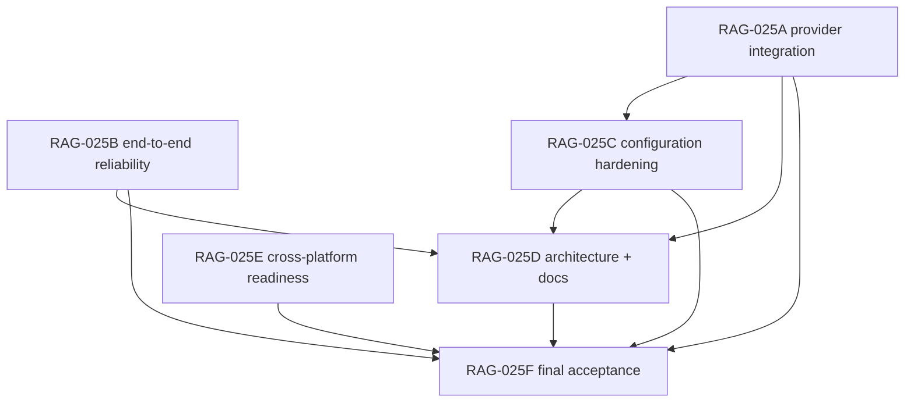

# PLAN — RAG-025: Architecture assessment and implementation planning

**Type:** Correctness-hardening + architecture/documentation plan (provider integration,
reliability, configuration, docs, cross-platform). **No bilingual-retrieval work** (deferred by
RAG-024).
**Status:** PROPOSED — not activated. Requires operator approval before any task runs.
**Baseline:** `main` at `79ed678785767608422f8a05d1bd0bb565a7122b` (RAG-024 completed,
historicalized, pushed).
**Does not:** reopen the deferred multilingual cross-lingual retrieval backlog
(`docs/rq-007-deferred-bilingual-backlog.md`), implement Phase 23b (PDF/OCR), change frozen
evaluation datasets, or alter production defaults without a recorded decision.

## Project
rag-template

## Summary

Harden the shipped RAG template around five seams — provider integration, end-to-end
reliability, configuration, architecture/documentation, and cross-platform readiness — with
concrete, verifiable deliverables. The read-only preflight found one verified **P0** defect (the
provider registry is not wired into the commands, so `EMBED_PROVIDER`/`GEN_PROVIDER` are ignored
while the docs claim they work) plus P1/P2 gaps (no fail-fast provider validation; README/Go
version and cross-platform notes; documentation drift for RAG-024). This plan fixes the P0/P1
items and records the rest. It is additive and default-preserving: no production retrieval,
generation, ingestion, or scoring behaviour changes except the intended provider-selection
wiring.

## Assessment context (from the read-only preflight)

- **P0 (verified defect):** `cmd/rag`, `cmd/eval`, `cmd/ingest` construct embedders/generators
  with `embedding.New(cfg.OllamaClient(), …)` / `generation.New(…)` directly; they never call
  `cfg.Embedder()` / `cfg.Generator()`. The provider registry (`internal/provider`) is therefore
  unreachable from every command, `EMBED_PROVIDER`/`GEN_PROVIDER` are silently ignored, and
  `docs/reference/configuration.md`, `docs/architecture/OVERVIEW.md`, and
  `docs/reference/capabilities.md` assert provider independence that does not hold.
- **P1:** `config.Load` does not validate provider names (an unknown provider is ignored, not a
  fail-fast error); README says "Go 1.26 or newer" while a clean `govulncheck` needs the 1.27.2
  toolchain; no cross-platform prerequisites are documented (`scripts/*.sh` are POSIX `sh`,
  `Makefile` is Unix-oriented, DB via `docker-compose`); the RAG-024 harness `cmd/expbilingual`
  is undocumented.
- **P2:** optional polish (Windows-native support, docs index for RAG-024/RAG-025, README
  architecture accuracy for the hybrid pipeline).

## RAG-025A — Provider integration

Wire the existing provider registry into the command entry points and prove selection works.

### Deliverables
- `cmd/rag/main.go`, `cmd/eval/main.go`, `cmd/ingest/main.go` resolve the embedder/generator
  through `cfg.Embedder()` / `cfg.Generator()` (the provider registry) instead of constructing
  vendor clients directly; **default Ollama behaviour is unchanged**.
- `internal/config/config.go` — **fail-fast validation of `EMBED_PROVIDER`/`GEN_PROVIDER` at
  `Load`** (moved here from RAG-025C): an unknown provider returns an error naming the variable
  and value; never a silent ignore.
- `internal/provider/stub_test.go` (new) + `internal/provider/provider_test.go` — a **deterministic,
  network-free stub provider** and tests covering provider **selection** and the
  **unsupported-provider error** path.
- Corrected docs (no longer overstating wiring): `docs/reference/configuration.md`,
  `docs/architecture/OVERVIEW.md`, `docs/reference/capabilities.md`.

### Acceptance Criteria
- `EMBED_PROVIDER=<unsupported>` / `GEN_PROVIDER=<unsupported>` fail fast with an error naming the
  variable and value (no silent ignore), covered by a test.
- The default configuration produces byte-identical embed/generate behaviour (test).
- Stub-provider tests are **deterministic and network-free** and cover selection + error.
- Real-Ollama smoke testing is **optional and reported separately** (not a required gate).
- `go build ./...`, `go vet ./...`, `go test ./... -count=1`, `go test -race ./...` pass; no change
  beyond provider selection.

### Dependencies
- none

## RAG-025B — End-to-end reliability

Exercise the full ingest → retrieve → generate path and its failure/cancellation/timeout paths.

### Deliverables
- End-to-end tests in a **new** file `internal/rag/e2e_test.go` (or `cmd/rag/e2e_test.go`) over a
  disposable DB using a **deterministic, network-free stub provider/generator**: ingest →
  retrieve → generate completes, provenance/metrics recorded.
- `internal/rag/reliability_test.go` — failure (endpoint/generation error → clear error, no
  partial write), context cancellation (no hang), and request timeout (bounded failure) tests.
- Disposable-DB harness usage documented in `docs/guides/testing.md` (never `rag_db`).
- **Create `docs/rag-025b-e2e-evidence.md`** — the RAG-025B evidence record. It must contain:
  the exact integration-test commands; the disposable database identity and the safety guard
  (refuses `rag_db`); evidence of ingestion, **pgvector** retrieval, and generation; the
  atomicity and reliability test results; the standard Go validation results; and an explicit
  note that real-Ollama testing is optional.

### Acceptance Criteria
- Stub-provider E2E test is **deterministic and network-free**; it is covered by a test that runs
  in the standard suite (skips without a DB).
- Failure, cancellation, and timeout paths are covered by tests that **do not** touch `rag_db`.
- Ingestion remains atomic (a failing batch rolls back the whole replacement).
- Real-Ollama smoke testing is **optional and reported separately**.
- Gates pass; disposable-PostgreSQL integration tests pass; evidence records commands/config/hashes.
- **The evidence document `docs/rag-025b-e2e-evidence.md` exists** and records the integration
  commands, the disposable-DB identity + `rag_db` guard, ingestion/pgvector-retrieval/generation
  evidence, the atomicity + reliability results, and the Go gate results.

### Dependencies
- none

## RAG-025C — Configuration hardening

Validate required settings and defaults and prevent accidental production-database access.

### Deliverables
- `internal/config/config_test.go` — a test-only guard refusing destructive DB tests against a
  non-disposable database (e.g., require an explicit test-DB marker or a non-`rag_db` name).
- Provider-specific configuration documented in `docs/reference/configuration.md` (Ollama today;
  how to add a provider) — noting that **fail-fast provider validation lives in RAG-025A**.

### Acceptance Criteria
- Tests cannot silently target `rag_db` (guard covered by a test).
- Defaults and their precedence are documented and matched by tests.
- `go build ./...`, `go vet ./...`, `go test ./... -count=1`, `go test -race ./...` pass.

### Dependencies
- RAG-025A

## RAG-025D — Architecture and documentation

Align module boundaries and documentation with the shipped code.

### Deliverables
- `docs/architecture/OVERVIEW.md` updated: package responsibilities and boundaries, the provider
  seam as actually implemented, the hybrid retrieval pipeline, and the evaluation harness
  (`cmd/expbilingual`).
- `README.md` corrected: supported Go version (toolchain for a clean `govulncheck`), the command
  set (including evaluation tooling), and accurate architecture notes.
- `docs/README.md` index updated for RAG-024 and RAG-025 artifacts; setup, architecture, and
  smoke-test guidance documented.

### Acceptance Criteria
- No documentation claim contradicts the code (provider wiring, commands, Go version,
  architecture diagram).
- The docs index links resolve (no broken new links).
- Documentation-only changes; no production code change.
- Validation: `git diff --check`; link check where available.

### Dependencies
- RAG-025A
- RAG-025B
- RAG-025C
- RAG-025E

## RAG-025E — Cross-platform readiness

Assess macOS, Linux, and Windows support and record prerequisites and gaps.

### Deliverables
- `docs/operations/platform-support.md` (new) — a written assessment of macOS, Linux, and
  Windows support: Go build/run per OS; the POSIX `sh` scripts and `Makefile` (WSL/Git-Bash on
  Windows); `docker-compose`/pgvector prerequisites; path and file handling in
  `internal/loader`/`cmd/ingest` (PDF, Markdown); any OS-specific assumptions.
- A prioritized list of platform gaps with the smallest safe remediation (documentation first;
  code changes only if separately authorized).

### Acceptance Criteria
- Each of macOS, Linux, and Windows is classified (supported / supported-with-prerequisites /
  gaps) with concrete evidence from the repo.
- No code change required beyond documentation in this task unless separately authorized.
- Validation: documentation-only; `git diff --check`.

### Dependencies
- none

## RAG-025F — Final acceptance and historicalization

Verify all authorized work and prepare closure evidence.

### Deliverables
- **Create `docs/plans/PLAN-RAG-025-closure.md`** — the final acceptance note recording: the
  RAG-025A–E outcomes, the P0/P1 resolution status (provider wiring fixed, docs corrected,
  config validated), the preserved RAG-023/RAG-024 evidence and frozen datasets, and that
  production defaults are unchanged (or changed only with a recorded decision).
- Native Go validation evidence; the plan is then a candidate for `/sop-historicalize`.

### Acceptance Criteria
- Every acceptance criterion above is satisfied or explicitly waived by the operator.
- `go build ./...`, `go vet ./...`, `go test ./... -count=1`, `go test -race ./...`, and
  `govulncheck ./...` (Go 1.27.2) pass; `git diff --check` clean.
- No production default changed without a recorded decision; frozen datasets and RAG-023/RAG-024
  archives untouched.
- Validation: full gate set; historicalization performed only as a separate explicit step.

### Dependencies
- RAG-025A
- RAG-025B
- RAG-025C
- RAG-025D
- RAG-025E

## Dependency graph

## Parallel execution groups

- **Group 1 (parallel):** RAG-025A, RAG-025B, RAG-025E — independent; use **isolated
  worktrees/databases** and never run concurrent SOP state transitions on the same plan.
- **Group 2:** RAG-025C (depends on A).
- **Group 3:** RAG-025D (depends on A+B+C).
- **Group 4 (serial):** RAG-025F (depends on all).
- **Critical path:** A → C → D → F.

## Safety and constraints

- Disposable PostgreSQL databases only; **never** modify `rag_db`.
- Frozen evaluation datasets and the `0.70` threshold unchanged; **do not** reopen the deferred
  multilingual retrieval work (`docs/rq-007-deferred-bilingual-backlog.md`).
- Preserve RAG-023/RAG-024 historical evidence and archives; preserve unrelated user-owned
  files (`docs/plans/PLAN-RAG-Phase-23.md`, `docs/sop-defect-historicalize-stale-approval.md`).
- No model downloads; bound all external commands/model calls with timeouts.
- Provider-wiring changes keep default behaviour identical unless a recorded decision says
  otherwise.
- This plan is **PROPOSED**: do not activate, implement, commit, or push until the operator
  approves.
